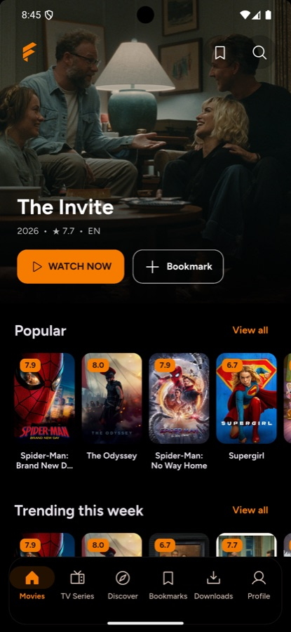
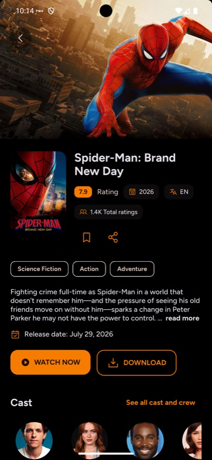
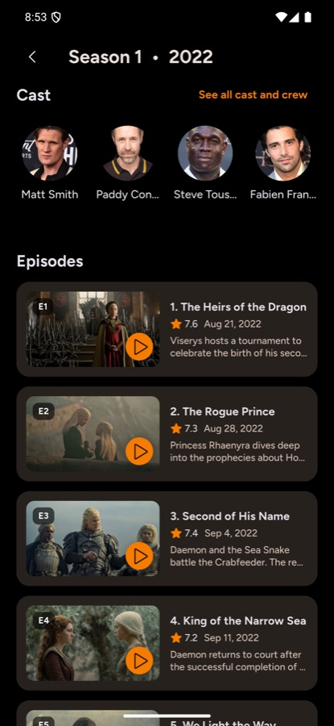

<p align="center"></p>
<h1 align="center">FlixQuest</h1>

An open-source Flutter movie and TV catalog for Android phones, tablets, and Android TV.

## Features

- Movie and series discovery, trending titles, genres, and search powered by TMDB.
- Cast, crew, trailers, images, seasons, and episode information.
- Device-local bookmarks and custom watchlists.
- Mobile, tablet, and remote-friendly TV layouts.
- Localization, dark and light themes, ambient colors, and seasonal themes.

This public edition runs without a hosted application backend, user accounts, cloud sync, advertising, or stream scraping. Trailers open in an external YouTube app or browser. Movie and episode streaming and downloads are excluded.

## Build

Use the Flutter version in `.fvmrc` (3.35.7). Get your own TMDB API key from [TMDB](https://www.themoviedb.org/settings/api).

```sh
flutter pub get
flutter run --dart-define=TMDB_API_KEY=YOUR_TMDB_API_KEY
flutter build apk --release --dart-define=TMDB_API_KEY=YOUR_TMDB_API_KEY
```

The default Android flavor is `prod`; `--flavor dev` selects the development launcher label. Public builds use a separate Android application ID. No private player checkout, environment file, Firebase app registration, or native secret is required.

A release build uses `android/key.properties` when present and the debug signing configuration for local builds otherwise. Supply your own signing key before distributing a release; never commit keystores or credentials.

## Contribute

```sh
dart format lib test
flutter analyze
flutter test
```

Keep configuration values and credentials out of Git. Changes to the public edition must remain buildable without production services.

## Screenshots

| Movies | Title details | Episodes |
| --- | --- | --- |
|  |  |  |

## Credits and license

Metadata and artwork are provided by TMDB. This application is not endorsed or certified by TMDB. Initial UI inspiration: [Matinee Flutter](https://github.com/bimsina/Matinee-Flutter).

Licensed under [GPL-3.0](LICENSE). Preserve the license and copyright notices when redistributing.
